<a href="https://subhadeep998.github.io">
  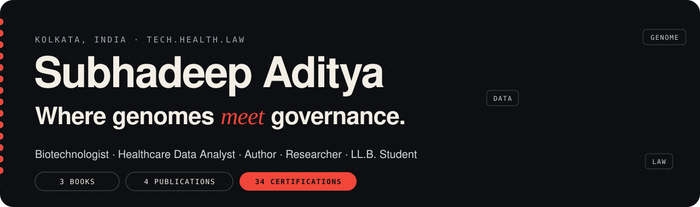
</a>

<p align="center">
  <a href="https://github.com/Subhadeep998">
    
  </a>
</p>

<p align="center">
  <a href="https://subhadeep998.github.io"></a>
  <a href="https://www.linkedin.com/in/subhadeep-aditya-080970145/"></a>
  <a href="https://www.researchgate.net/profile/Subhadeep-Aditya"></a>
  <a href="#-the-bookshelf"></a>
  <a href="mailto:info@subhadeepaditya.in"></a>
</p>

<p align="center">
  <a href="https://github.com/Subhadeep998?tab=followers"></a>
  
</p>

<p align="center">
  <i>“Empowering better healthcare decisions — through science, data, stories and law.”</i>
</p>

---

## ✦ Four strands, one helix

I'm a **biotechnology postgraduate, healthcare data analyst, consultant, author and independent researcher** based in Kolkata — now studying law to work where science, technology and regulation collide.

<table>
  <tr>
    <td width="25%" valign="top">
      <h3>i. Scientist</h3>
      M.Sc. &amp; B.Sc. (Hons.) in Biotechnology. Research on genome stability and bacterial quorum sensing. Drawn to <b>cancer genomics</b> and <b>precision medicine</b>.
    </td>
    <td width="25%" valign="top">
      <h3>ii. Analyst</h3>
      <b>3+ years</b> in healthcare intelligence, medical-device data operations and product information management at <b>GlobalData</b>, <b>Vatrix Healthcare</b> and <b>GHX</b>.
    </td>
    <td width="25%" valign="top">
      <h3>iii. Author</h3>
      <b>Three books</b> — a healthcare consulting handbook, a mythic techno-thriller and a journey through Alzheimer's disease.
    </td>
    <td width="25%" valign="top">
      <h3>iv. Legal mind</h3>
      <b>LL.B.</b> at Techno India University. Focused on <b>healthcare law, IP and AI governance</b>. Member, American Bar Association.
    </td>
  </tr>
</table>

> **Now:** LL.B. student · open to **law-firm internships** · running the **OncoGenome** cancer-genomics research project · maintaining **8 open-knowledge hubs**

---

## ✦ Open knowledge — free for everyone

Eight free hubs for students, researchers and professionals. **Star ⭐ the ones you use** — it helps others find them.

### 📖 Learn

<table>
  <tr>
    <td width="33%" valign="top" align="center">
      <a href="https://github.com/Subhadeep998/Awesome-Biotechnology">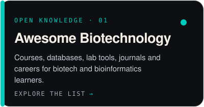</a>
      <br><sub>180+ hand-picked courses, databases, tools, journals &amp; careers — plus a weekly bioRxiv feed.</sub>
    </td>
    <td width="33%" valign="top" align="center">
      <a href="https://github.com/Subhadeep998/Awesome-AI-Learning">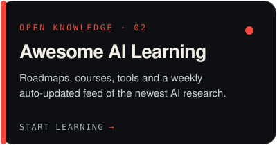</a>
      <br><sub>Zero-to-agents roadmap, free certificates, live model trackers — plus a weekly arXiv &amp; GitHub feed.</sub>
    </td>
    <td width="33%" valign="top" align="center">
      <a href="https://github.com/Subhadeep998/Open-Biology-Handbook">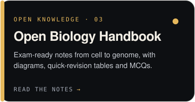</a>
      <br><sub>10 exam-ready chapters with diagrams, revision tables and 50 MCQs — for NEET, CUET, GAT-B, CSIR-NET &amp; GATE.</sub>
    </td>
  </tr>
</table>

### 🛰️ Track — refreshed automatically every day

<table>
  <tr>
    <td width="50%" valign="top" align="center">
      <a href="https://github.com/Subhadeep998/Science-Research-Radar">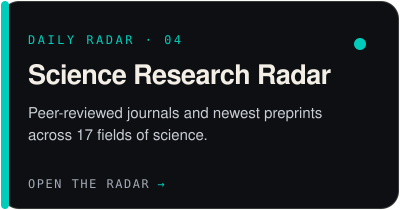</a>
      <br><sub>Research only: Nature, Science, Cell, NEJM, Lancet &amp; more + newest preprints across 17 fields · <a href="https://github.com/Subhadeep998/Science-Research-Radar/blob/main/LATEST.md">today's digest →</a></sub>
    </td>
    <td width="50%" valign="top" align="center">
      <a href="https://github.com/Subhadeep998/Global-Company-Radar">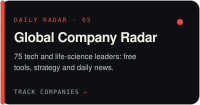</a>
      <br><sub>Tesla, SpaceX/xAI, NVIDIA, Anthropic, Google, Pfizer, AstraZeneca, TCS, Biocon &amp; 66 more — free tools, strategy, news · <a href="https://github.com/Subhadeep998/Global-Company-Radar/blob/main/NEWS.md">today's digest →</a></sub>
    </td>
  </tr>
  <tr>
    <td width="50%" valign="top" align="center">
      <a href="https://github.com/Subhadeep998/Law-Firm-Radar"></a>
      <br><sub>Kirkland, Linklaters, Cyril Amarchand &amp; 27 more — deals, insights, internships + a free legal research toolkit · <a href="https://github.com/Subhadeep998/Law-Firm-Radar/blob/main/NEWS.md">today's digest →</a></sub>
    </td>
    <td width="50%" valign="top" align="center">
      <a href="https://github.com/Subhadeep998/AI-Developer-Docs-Hub">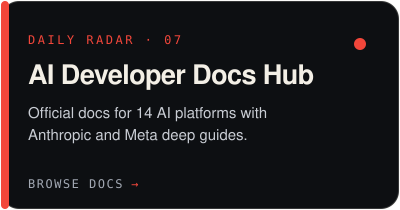</a>
      <br><sub>Deep guides for <a href="https://github.com/Subhadeep998/AI-Developer-Docs-Hub/tree/main/anthropic">Anthropic</a> &amp; <a href="https://github.com/Subhadeep998/AI-Developer-Docs-Hub/tree/main/meta">Meta</a>, maps for 12 more providers + a daily SDK release tracker.</sub>
    </td>
  </tr>
  <tr>
    <td colspan="2" valign="top" align="center">
      <a href="https://subhadeep998.github.io/India-Development-Dashboard/">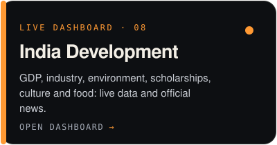</a>
      <br><sub><b>New:</b> live interactive dashboard — India's GDP, national income, industry, environment, scholarships, arts &amp; culture and food, with official news (PIB, DD News, AIR) twice a day · <a href="https://subhadeep998.github.io/India-Development-Dashboard/">open the dashboard →</a></sub>
    </td>
  </tr>
</table>

### 📡 Live from my radars

<!-- live:start -->
| Radar | Today's top item |
|:--|:--|
| 🏢 [**Company Radar**](https://github.com/Subhadeep998/Global-Company-Radar) | [Black Friday Apple deals 2026: Record prices on AirPods, MacBooks, Apple Watch](https://news.google.com/rss/articles/CBMiZkFVX3lxTE1DTUxKNXNDWGFDTW9LcmtmeUxDUjM3UUJqOG1BbWFsRk52MUZoem0waUNCRmQyYjJMWlh3V1kxaXhxaDZkTGNWX1B0bF9uVFdGLWxrNW1faVVPVjl1dGplbmNDYnk2Zw?oc=5) — _Apple_ |
| ⚖️ [**Law Firm Radar**](https://github.com/Subhadeep998/Law-Firm-Radar) | [Kirkland & Ellis under fire from private equity backers over sell-to-yourself deals](https://news.google.com/rss/articles/CBMihAFBVV95cUxOdHZYQk9OdXJDZFRZN0xTY0RjTHF3OVY4ZEtVVWNMY0pTM25fbVEtUnU5b2lTX19PNWFFRkJ5VDlROWt1a0VxVVpkZGhPcFdQYjdMWTlHMGYzOTVhV3A1QXVfNTRlLW15LXMtTU93UXZXZVRkdFdiWm50YnlMUEJjRFhHbHQ?oc=5) — _Kirkland Ellis_ |
| 🔬 [**Science Radar**](https://github.com/Subhadeep998/Science-Research-Radar) | [Transcription from megabase-scale heterochromatin generates neural barcodes](https://doi.org/10.1038/s41586-026-11311-y) — _Nature_ |
| 🤖 [**AI Docs Hub**](https://github.com/Subhadeep998/AI-Developer-Docs-Hub) | [meta-llama/llama-stack **v2.0.0**](https://github.com/ogx-ai/ogx/releases/tag/v2.0.0) — _released 2026-11-26_ |
| 🇮🇳 [**India Dashboard**](https://github.com/Subhadeep998/India-Development-Dashboard) | [Rs 1,05,155 crore of gross GST revenue collected in the month of October 2020](https://news.google.com/rss/articles/CBMi6wFBVV95cUxQaDBObmhDV3ZMWFBndGlsMXd2a00wdHJ1NmE2cEVIajZ0Znl5Znc1Zm1kRm1XdmFJQnJwSzd6Y0ZoZGFpdUt6bFVEcXZDeWhsNi1jX0I1WktjQVZiUWRtS3NZTnVxeUtzMzJyRDJWTG1Cb0p1NEdZanpCOXlXUms5WTlLb2NvaG1iZ21zT21sVFNUNDlfamtQeVlCVkpvdHdMT3hoRDhVbmxza2U1cjdvb0tWbTUxM3VNZEVNXzNkSmhqZktNYXNUOUthZHFCV3JaN29HaTRnVVJGcXNUd2VGd1A1QVBuUkR6THlj?oc=5) — _PIB_ |

<sub>8 open-knowledge hubs · 5 refresh daily · updated automatically 27 Nov 2026 · all free and open</sub>
<!-- live:end -->

---

## ✦ The bookshelf

<table>
  <tr>
    <td align="center" width="33%" valign="top">
      <a href="https://www.amazon.in/dp/B0HD9SY43K">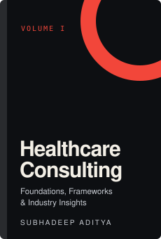</a>
      <br><b>Healthcare Consulting</b>
      <br><sub>Foundations, Frameworks &amp; Industry Insights — The Complete Practitioner Handbook, Vol. I</sub>
      <br><a href="https://www.amazon.in/dp/B0HD9SY43K">Read on Kindle →</a>
    </td>
    <td align="center" width="33%" valign="top">
      <a href="https://www.amazon.in/dp/B0FL3S14H6">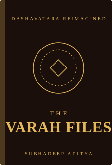</a>
      <br><b>The Varah Files</b>
      <br><sub>Dashavatara Reimagined — a mythic techno-thriller. A data breach at the Port of Kolkata spirals into a national crisis, and the ten avatars return as modern archetypes.</sub>
      <br><a href="https://www.amazon.in/dp/B0FL3S14H6">Read on Kindle →</a>
    </td>
    <td align="center" width="33%" valign="top">
      <a href="https://www.amazon.in/dp/B0G4KL9H5B">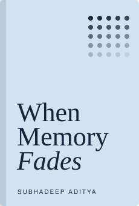</a>
      <br><b>When Memory Fades</b>
      <br><sub>The Silent Epidemic of Alzheimer's Disease — a journey through science, suffering and hope</sub>
      <br><a href="https://www.amazon.in/dp/B0G4KL9H5B">Read on Kindle →</a>
    </td>
  </tr>
</table>

---

## ✦ Research

**Interests:** `Cancer Genomics` · `Precision Medicine` · `Artificial Intelligence` · `Healthcare Systems` · `Intellectual Property` · `Technology Regulation`

### Publications

| Year | Title | Venue |
|:--|:--|:--|
| 2026 | [**The Kidney as a Master Regulator of Blood Pressure and Cardiac Function: A Comprehensive Review**](https://www.ijsr.net/getabstract.php?paperid=SR26303231817) | IJSR |
| 2025 | [**Redefining Alzheimer's Treatment in 2025: New Drug Breakthroughs and Next-Generation Diagnostics**](https://figshare.com/articles/poster/Redefining_Alzheimer_s_Treatment_in_2025_New_Drug_Breakthroughs_and_Next-Generation_Diagnostics/30340270) | Academia · Figshare |
| 2025 | [**The Varah Files: Dashavatara Reimagined**](https://www.amazon.in/dp/B0FL3S14H6) | Amazon Kindle |
| 2021 | **A Comparative Study on COVID-19 Coronavirus Variants: Alpha, Beta, Gamma, Delta** | IJRASET |

### Projects

| | Project | Where |
|:--|:--|:--|
| 🔴 **Ongoing** · Oct 2026 – | **OncoGenome: Cancer Genomics Research** — cancer-associated genomic alterations, molecular biomarkers and precision oncology through literature analysis | NextLeap Advisory |
| 2021 | **Role of Replication Factor C-Like Complexes (RLCs) in Maintaining Genome Stability** — lessons from budding and fission yeast | Amity University Kolkata |
| 2019 – 2020 | **Targeting Quorum Sensing in *Vibrio cholerae*** | Adamas University |

---

## ✦ The sequence so far

```text
●  Ongoing          LL.B. (three-year programme) ............ Techno India University, Kolkata
│
●  11/2024–03/2025  Data Specialist ......................... GHX India, Hyderabad
│                   Medical-surgical device & supply data, product data operations
│
●  06/2024–10/2024  Healthcare Analyst ...................... Vatrix Healthcare Data India, Hyderabad
│                   Market & competitor research (Factiva, ECRI, Sigma) · whitepapers & reports
│
●  03/2022–05/2024  Associate Healthcare Analyst ............ GlobalData PLC, Hyderabad
│                   SKU intelligence · neuromodulation · diagnostic catheters · growth hormones
│                   ↳ cut turnaround time by 20%
│
●  2022             M.Sc. Biotechnology ..................... Amity University Kolkata
●  2020             B.Sc. (Hons.) Biotechnology ............. Adamas University, Kolkata
```

<details>
<summary><b>Healthcare intelligence trackers I've built</b></summary>
<br>

- Ligation Devices SKU Tracker — Medtronic PLC
- Peripheral Nerve Repair Tracker — Nephron
- Neuromodulation Devices Tracker — Wells Fargo &amp; Nephron Research
- Diagnostic Catheters Tracker — Bloomberg
- Human Growth Hormone Tracker

</details>

---

## ✦ Ventures

<table>
  <tr>
    <td width="50%" valign="top">
      <h3>NextLeap Advisory</h3>
      <sub>FOUNDER · EDUCATIONAL CONSULTING</sub><br><br>
      An educational consulting platform guiding learners and professionals toward their next leap. Home of the <b>OncoGenome</b> research project and the free <a href="https://github.com/Subhadeep998/Open-Biology-Handbook">Open Biology Handbook</a>.
    </td>
    <td width="50%" valign="top">
      <h3>ChobiGhor Studios</h3>
      <sub>FOUNDER · PHOTOGRAPHY &amp; ART</sub><br><br>
      Exploring Kolkata's heritage through photography and art — the city's lanes, facades and stories, one frame at a time.
    </td>
  </tr>
</table>

---

## ✦ Toolkit

<p>
  
  
  
  
  
  
  
  
  
  
  
  
  
</p>

---

## ✦ GitHub at a glance

<p align="center">
  
  
</p>

<p align="center">
  
</p>

<p align="center">
  <picture>
    <source media="(prefers-color-scheme: dark)" srcset="https://raw.githubusercontent.com/Subhadeep998/Subhadeep998/output/snake-dark.svg">
    
  </picture>
</p>

---

## ✦ Credentials

**Honours &amp; memberships**

| | |
|:--|:--|
| 🏛️ **American Bar Association** — Member (2026) | 🦠 **World Society for Virology** — Member (2026) |
| 🔬 **American Society for Microbiology** — Global Outreach Contributing Member (2024) | 🧫 **Microbiology Society, UK** — Affiliate Member (2020) |
| 🎓 **Chancellor's Scholarship** — Adamas University (2018) | 🏅 **Infinity Merit Award** — Infinity Educare (2017) |

**Highlights:** Oxford Faculty of Law · Johns Hopkins · WHO · Anthropic · OpenAI · Google · McKinsey.org

<details>
<summary><b>All 34 certifications</b></summary>
<br>

**Law &amp; Policy**
- AI, Justice and Rule of Law — *Faculty of Law, University of Oxford* (2026)
- Fundamentals of Medical Laws in India — *Manupatra Academy* (2026)

**AI**
- Claude Academy: AI Fluency — Framework &amp; Foundations — *Anthropic* (2026)
- Claude Academy: Claude Code in Action — *Anthropic* (2026)
- Agents and Workflows — *OpenAI Academy* (2026)
- Large Language Models (LLMs) Concepts — *DataCamp* (2025)
- Generative AI Foundations — *upGrad* (2025)
- Introduction to Machine Learning on AWS — *Amazon Web Services* (2023)

**Data &amp; Business**
- SAP MM Module — SAP S/4HANA Enterprise Package — *EME Academy* (2026)
- Internal Audit Job Simulation — *Goldman Sachs · Forage* (2025)
- McKinsey.org Forward Program — *McKinsey &amp; Company* (2025)
- Data Analytics Job Simulation — *Deloitte Australia · Forage* (2025)
- Healthcare Supply Chain 101 — *GHX* (2025)
- Introduction to Business Intelligence — *Infosys Springboard* (2024)
- Fundamentals of Data Analysis in Excel — *Corporate Finance Institute* (2024)
- Excel Modeling Tips and Tricks — *LinkedIn Learning* (2024)
- Python Foundations for Data Analysis &amp; BI — *Udemy* (2023)
- Foundations: Data, Data, Everywhere — *Google* (2023)

**Project &amp; Quality**
- Six Sigma Green Belt (CSSGB) — *IIBA* (2026)
- Six Sigma White Belt — *Council for Six Sigma Certification* (2024)
- Workflow Specialist — *Asana* (2024)
- Cert Prep: PMI Agile Certified Practitioner (PMI-ACP) — *LinkedIn Learning* (2024)
- Google Project Management Professional Certificate — *Google* (2023)
- Miro Essentials — *Miro* (2022)

**Life Sciences**
- Understanding Cancer Metastasis — *Johns Hopkins University* (2021)
- Introduction to Bioinformatics — *OmicsLogic* (2020)
- Virus Replication Centers during Murine Polyomavirus Infection — *LabRoots* (2020)
- The Art and Science of Haematology Morphology — *LabRoots* (2020)
- Introduction to Indoor Air Quality — *HKUST* (2020)
- Emerging Respiratory Viruses, incl. COVID-19 — *World Health Organization* (2020)
- Infection Prevention and Control for Novel Coronavirus — *World Health Organization* (2020)
- Human Health and Climate Change — *UNITAR* (2020)
- Genomics: Decoding the Universal Language of Life — *University of Illinois Urbana-Champaign*
- Impact of Microbes on Environment and Society — *Microbiology Society* (2018)

</details>

---

## ✦ Let's build something worth regulating

<p align="center">
  <b>Healthcare · genomics · AI · law — if that intersection interests you, let's stay connected.</b><br>
  <a href="https://github.com/Subhadeep998?tab=followers"></a>
</p>

| General | Research | Say hello | Legal |
|:--|:--|:--|:--|
| [info@subhadeepaditya.in](mailto:info@subhadeepaditya.in) | [research@subhadeepaditya.in](mailto:research@subhadeepaditya.in) | [hello@subhadeepaditya.in](mailto:hello@subhadeepaditya.in) | [legal@subhadeepaditya.in](mailto:legal@subhadeepaditya.in) |

<br>

<p align="center">
  <a href="https://subhadeep998.github.io">
    <picture>
      <source media="(prefers-color-scheme: dark)" srcset="assets/logo-dark.png">
      
    </picture>
  </a>
  <br>
  <sub>Kolkata, India · <a href="https://subhadeep998.github.io">subhadeep998.github.io</a> · <a href="https://www.subhadeepaditya.in">subhadeepaditya.in</a></sub>
</p>
